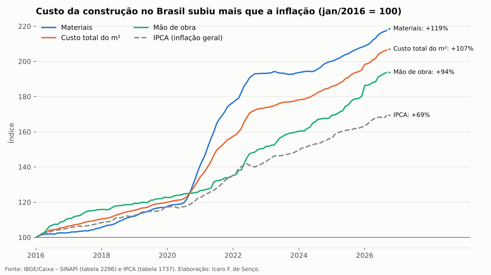
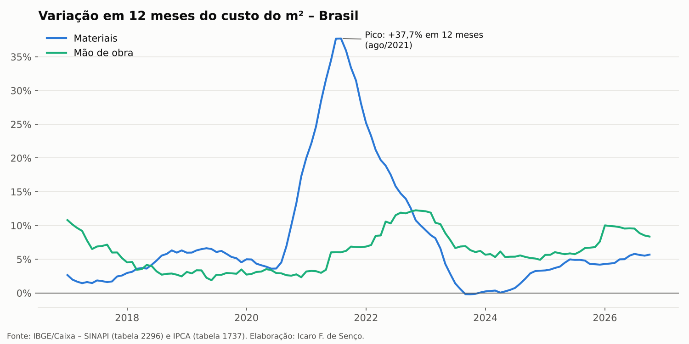
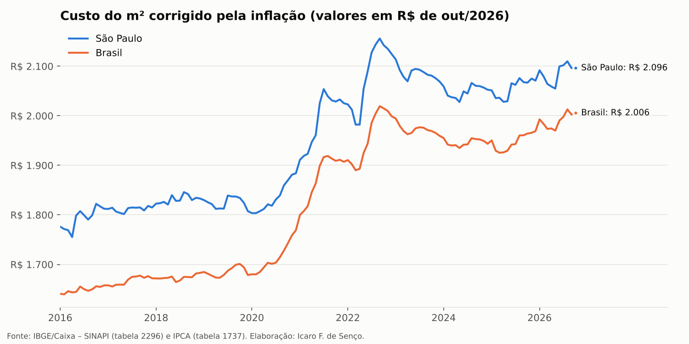
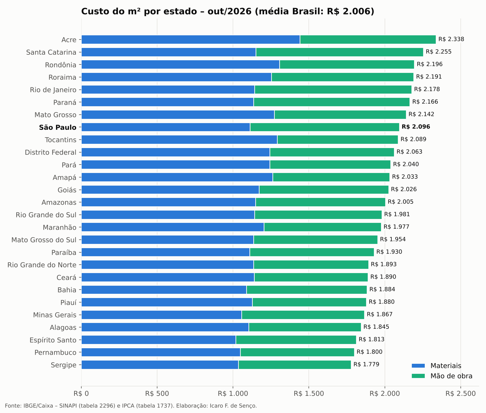

# Quanto ficou mais caro construir no Brasil? Análise do SINAPI (2016–2026)

Análise do **custo médio do metro quadrado da construção civil** no Brasil, por região e por estado, com dados oficiais do **SINAPI** (IBGE/Caixa). Também comparo esse custo com a **inflação (IPCA)**.

Sou engenheiro civil em transição para a área de dados. Neste projeto junto as duas coisas: a pergunta é de quem orça obra, e a resposta sai de um pipeline em Python + SQL que coleta, trata, valida e analisa os dados direto da API do IBGE.

## Principais resultados (jan/2016 a out/2026)

| Indicador | Resultado |
|---|---|
| Custo do m² no Brasil | de R$ 968,70 para **R$ 2.005,57** (+107,0%) |
| Inflação no período (IPCA) | +69,4% |
| Alta **acima da inflação** | **+22,2%** no Brasil e +18,0% em São Paulo |
| Materiais × mão de obra | +118,5% × +93,8% |
| Pico da alta de materiais | **+37,7% em 12 meses** (ago/2021) |
| m² mais caro / mais barato (out/2026) | Acre (R$ 2.338,39) / Sergipe (R$ 1.778,93) |
| São Paulo | 8º m² mais caro do país (R$ 2.096,45) |

**Em resumo:** construir ficou mais caro que a média de preços da economia. Quem puxou foram os materiais, que dispararam entre 2020 e 2022 com a pandemia e nunca voltaram ao patamar anterior. Depois de 2023, a mão de obra passou a subir mais rápido que os materiais.

### Custo da construção × inflação


### Variação em 12 meses: o choque dos materiais em 2021


### Custo do m² em valores de hoje (corrigido pelo IPCA)


### Custo do m² por estado


## Perguntas respondidas

1. Quanto o custo do m² subiu desde 2016, e quanto disso foi acima da inflação?
2. O que pesou mais: materiais ou mão de obra? Em que momento?
3. Como São Paulo se compara ao Brasil e às outras regiões?
4. Quais estados têm o m² mais caro e mais barato hoje?

## Como o projeto funciona

```
API IBGE (SIDRA v3)  ->  coleta.py  ->  data/raw/*.csv  ->  tratamento.py  ->  data/processed/ + sinapi.db (SQLite)
                                                                                      |
                                                       analise.py  <-  sql/consultas.sql
                                                           |
                                         reports/figures/*.png + reports/resumo.md + reports/consultas/*.csv
```

| Etapa | O que faz |
|---|---|
| `src/coleta.py` | Consulta a API de agregados do IBGE (tabelas 2296 – SINAPI e 1737 – IPCA) e grava os dados em formato longo (tidy) |
| `src/tratamento.py` | Converte para formato largo e confere a consistência (**total = materiais + mão de obra**). Calcula índices base 100, variação em 12 meses, participação dos materiais e o custo em valores reais (corrigido pelo IPCA). Grava em CSV e SQLite |
| `sql/consultas.sql` | Consultas analíticas com CTE e funções de janela (`LAG`, `ROW_NUMBER`): ranking de UFs, variação anual, maiores altas mensais, alta acumulada por região |
| `src/analise.py` | Gera os gráficos, roda as consultas SQL e escreve o resumo com os números |
| `tests/` | Testes com `pytest`: formato da coleta (com a API simulada), consistência dos dados e conferência da variação em 12 meses calculada contra a **publicada pelo IBGE** |

## Como rodar

```bash
git clone https://github.com/IcaroSenco/sinapi-custo-construcao.git
cd sinapi-custo-construcao
pip install -r requirements.txt

python src/coleta.py        # opcional: baixa os dados mais recentes da API do IBGE
python src/tratamento.py
python src/analise.py
python -m pytest -q
```

Os dados brutos usados na análise já estão em `data/raw/`, então o projeto roda mesmo sem acesso à API.

## Estrutura

```
├── data/
│   ├── raw/          # dados como vêm da API (formato longo)
│   └── processed/    # tabelas tratadas (CSV) e banco SQLite
├── reports/
│   ├── figures/      # gráficos
│   ├── consultas/    # resultado de cada consulta SQL
│   └── resumo.md     # números principais, gerados automaticamente
├── sql/consultas.sql
├── src/              # coleta, tratamento e análise
└── tests/
```

## Decisões e limitações

- **Indicador:** o SINAPI/IBGE mede o custo de um **projeto residencial padrão**, sem terreno, projetos, licenças e lucro do construtor. É um bom termômetro de tendência, mas não substitui o orçamento de uma obra específica.
- **Valores reais:** corrigi pelo IPCA (inflação geral) para responder "subiu mais que os outros preços da economia?". Para outros usos, o INCC também é uma escolha válida.
- **Recorte:** a série mensal cobre Brasil, as 5 regiões e São Paulo. O ranking cobre as 27 UFs no último mês. A coleta aceita qualquer período (`--inicio`, `--fim`).

## Próximos passos

- Dashboard interativo (Power BI ou Streamlit) com filtro por estado.
- Incluir o preço dos insumos (cimento, aço, areia) a partir dos relatórios mensais da Caixa.
- Agendar a coleta mensal (GitHub Actions) para manter os dados sempre atualizados.

## Autor

**Icaro F. de Senço**: engenheiro civil (UNIP, 2017) e estudante de Análise e Desenvolvimento de Sistemas (UNIFAAT).
[LinkedIn](https://www.linkedin.com/in/icaro-f-de-sen%C3%A7o-816436116/) · [GitHub](https://github.com/IcaroSenco)

Fonte dos dados: IBGE – Sistema Nacional de Pesquisa de Custos e Índices da Construção Civil (SINAPI), tabela 2296, e IPCA, tabela 1737.
